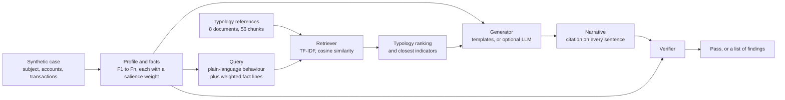

# SAR Narrative Generator

Live demo: https://ram-balasubramani.vercel.app/demo/sar

Portfolio: https://ram-balasubramani.vercel.app

Retrieval-augmented drafting of suspicious activity report (SAR) narratives for anti-money-laundering investigators. Every sentence in a draft carries a citation to a case fact or a reference indicator, and a verifier refuses any sentence whose numbers, dates or names are not in the sources it cites.

All data in this repository is synthetic. The people, companies, account numbers and transactions are produced by a seeded generator. This is a personal project. It is not connected to any employer or client and contains no client data.

## What it is and why

When a bank decides that account activity is suspicious, an investigator writes a narrative for the SAR. FinCEN's guidance on narratives asks for the who, what, when, where and why of the activity, and how it was carried out. Writing it means copying figures out of a case file: totals, counts, dates, branch names, counterparties. It is slow, and it is exactly the kind of text where a wrong digit matters.

A language model can produce fluent narrative text quickly. The problem is that fluent text with one invented amount is worse than no draft, because the investigator now has to check every figure. So the question I wanted to work on was not "can a model write this" but "can a draft be made checkable, sentence by sentence".

The project has four parts:

1. A synthetic case generator with a labelled typology (structuring, funnel account, and six others).
2. A retriever that matches a case to short reference documents on AML typologies.
3. A generator that writes the narrative with a citation on every sentence.
4. A verifier that parses the narrative back and checks each sentence against what it cites.

An evaluation harness scores all of it on 200 cases, including how many deliberately injected errors the verifier catches.

## A short example

This is the output of `python -m sarnarrative draft --seed 7`. I cut two blocks for length, the list of facts F1 to F17 and the list of closest reference chunks. Nothing else is edited.

```text
Case SYN-CASE-00007-VCO (synthetic data). Ground-truth label, not shown to the pipeline: VCO

Typology ranking from retrieval
  1. VCO  Virtual-currency off-ramp  (0.114)
  2. FUN  Funnel account  (0.075)
  3. STR  Structuring of cash transactions  (0.068)

Narrative (template generator, written for VCO)
  WHO
    The subject of this report is Alaric Fennimore, individual, age 44, hair stylist, resident of Mesa, AZ [F1].
  WHAT
    In that period the account received 7 credits totalling $78,300.68 and paid out 25 debits totalling $77,966.12 [F5][F6].
    The largest single transaction was $23,351.80 (incoming ACH transfer on 2025-09-04, counterparty Puddlecoin Exchange) [F7].
  WHEN
    The review covers 2025-08-31 to 2025-10-06 (37 days), during which the account recorded 32 transactions [F3][F4].
  WHERE
    The activity took place in account SYN-390661, personal checking, opened 2021-03-17 at the Mesa, AZ branch [F2].
  WHY
    At account opening the customer stated expected monthly activity of $4,900.00 [F8].
    The activity in this account resembles the reference typology Virtual-currency off-ramp [VCO-00].
    A red flag from that reference that may apply is: frequent or large transfers from virtual-currency exchanges into a bank account, followed by prompt cash withdrawals or outgoing wires [VCO-01].
    A red flag from that reference that may apply is: exchange payouts arrive soon after the account is opened or after a long period of dormancy [VCO-04].
    A red flag from that reference that may apply is: customer appears to operate as an unregistered peer-to-peer exchanger: many small incoming payments from individuals matched by transfers to exchanges [VCO-03].
  HOW
    Virtual-currency exchanges sent the account 5 credits totalling $75,136.66 (Puddlecoin Exchange) [F14].
    Cash left the account through 10 cash withdrawals totalling $73,360.00 [F10].
    The median time from a credit of $1,000.00 or more to the next debit of $1,000.00 or more was 2 days [F15].

Verifier: PASS (13 sentences, 13 with a valid citation, 0 findings)
```

The example also shows a weakness I come back to under limitations. The first red flag fits the case. The other two do not: the account was opened in 2021, and it received nothing from individuals. Indicators are picked by text similarity, which is why the sentence says "may apply" and why an investigator still has to read them.

To see the verifier refuse something, I changed one amount and one name in the text above and added a sentence with no citation:

```python
from sarnarrative.cases import generate_case
from sarnarrative.generate import draft
from sarnarrative.retrieval import default_retriever
from sarnarrative.verify import verify

case = generate_case(7)
d = draft(case, default_retriever())
text = d.narrative.to_text()
text = text.replace("5 credits totalling $75,136.66 (Puddlecoin Exchange) [F14]",
                    "5 credits totalling $95,136.66 (Vexley Marine Ltd) [F14]")
text += " The customer has since left the country."
for f in verify(text, case, d.references).findings:
    print(f.sentence_index + 1, f.kind, "-", f.detail)
```

```text
11 unsupported_amount - amount $95,136.66 does not appear anywhere in the case
11 unsupported_name - name Vexley Marine Ltd does not appear anywhere in the case
14 missing_citation - sentence has no citation
```

## How it works



**Cases** (`sarnarrative/cases.py`). A case is an ordinary baseline (salary, rent, card spending, or business running costs), plus the pattern for its labelled typology with randomly drawn parameters, plus, with probability 0.4, a weak overlay from a different pattern. The label is kept for scoring and is never passed to retrieval or generation. There is a test that relabels a case and checks the query does not change.

**Facts** (`sarnarrative/facts.py`). The transactions are reduced to a profile and then to citable facts with ids: totals, counts, the share of cash deposits made outside the home state, the median time between money arriving and leaving, and so on. A fact only exists when it has something to say, so the number varies: 15 to 26 per case in the evaluation set. Each fact carries a salience weight between 0 and 1, roughly the share of the period's money that it describes. Three small cash deposits in an account dominated by wires get a low weight.

**Typology references** (`typologies/`). Eight markdown files that I wrote from public AML knowledge: structuring, funnel account, rapid movement of funds, money mule, trade-based money laundering, shell company layering, elder financial exploitation and virtual-currency off-ramp. Each has a description, six red-flag indicators with stable ids such as `STR-03`, and a list of what a narrative should establish. Each file names the kind of public source it summarises. I did not quote document numbers or dates, because I did not want to cite anything I had not checked line by line.

**Retrieval** (`sarnarrative/retrieval.py`). Each description and each indicator is a chunk. The query has two kinds of lines: a plain-language description of the behaviour ("Most of the cash was deposited in other states, a long way from the customer's home branch.") and the fact lines weighted by salience. Typologies are ranked by cosine similarity between the query and each whole document. The indicators to cite are then the closest chunks inside the top document. The encoder sits behind a `fit` / `encode` interface. TF-IDF is the default and a sentence-transformers backend can be swapped in.

**Generation** (`sarnarrative/generate.py`). The default generator is a set of sentence templates, one per fact, grouped under who, what, when, where, why and how. It writes up the core facts plus the facts that matter for the retrieved typology. An optional LLM mode sends only the facts and the retrieved indicators to a chat-completions endpoint and asks for the same `[F3]` / `[STR-03]` citation format.

**Verification** (`sarnarrative/verify.py`). The verifier takes narrative text, not the generator's internal structure, so both generators go through the same parser. For each sentence it checks that there is a citation, that every cited id exists for this case, and that every money amount, date, count, percentage, identifier and capitalised name in the sentence appears in the cited facts or indicators. If a value is in the case but not in the cited source, that is reported as a different kind of finding from a value that appears nowhere.

## The live demo

The demo at the link above reads the three files in `web_export/`. Pick a case, see what retrieval proposes, read the cited draft, then change a figure and watch the check fail.

The verifier that runs in the browser is a TypeScript port of `sarnarrative/verify.py`. I ran both over 440 clean and corrupted drafts and compared every finding: 731 from the Python verifier and the same 731 from the port.

The demo can also ask a language model to write the draft, from the same facts and references and with the prompt in `sarnarrative/generate.py`. What the model writes is parsed and checked in the browser like any other draft. Those drafts are produced one at a time for whoever is on the page. They are not part of the evaluation below.

## Evaluation results

Produced by `python -m sarnarrative evaluate --ablation --with-neural` on 200 synthetic cases, 25 per typology, seed 1000, template generator. The run is deterministic, so the same command gives the same figures. The same metrics are in `web_export/eval.json`.

### Overall

| Metric | Result |
| --- | --- |
| Retrieval hit@1 (top-ranked typology is the label) | 78.0% |
| Retrieval hit@3 | 97.5% |
| Citation coverage (sentences with a valid citation) | 100.0% |
| Fact inclusion rate (key facts of the labelled typology cited in the draft) | 88.7% |
| Verifier pass rate on unmodified drafts | 100.0% |
| Mean sentences per draft | 15.73 |

### Per typology

| Typology | n | hit@1 | hit@3 | Fact inclusion | Verifier pass |
| --- | --- | --- | --- | --- | --- |
| STR structuring | 25 | 80.0% | 100.0% | 94.3% | 100.0% |
| FUN funnel account | 25 | 96.0% | 100.0% | 97.4% | 100.0% |
| RPM rapid movement | 25 | 100.0% | 100.0% | 100.0% | 100.0% |
| MUL money mule | 25 | 40.0% | 92.0% | 70.8% | 100.0% |
| TBM trade-based | 25 | 100.0% | 100.0% | 100.0% | 100.0% |
| SHL shell company | 25 | 72.0% | 100.0% | 87.8% | 100.0% |
| EFE elder exploitation | 25 | 36.0% | 88.0% | 52.3% | 100.0% |
| VCO virtual-currency off-ramp | 25 | 100.0% | 100.0% | 100.0% | 100.0% |

### Retrieval misses

44 of 200 cases had the wrong typology in first place.

| Label | Predicted | Count |
| --- | --- | --- |
| EFE | VCO | 11 |
| MUL | VCO | 8 |
| MUL | FUN | 7 |
| SHL | RPM | 7 |
| EFE | MUL | 5 |
| STR | FUN | 5 |
| FUN | STR | 1 |

### Corruption catch rate

One error of each type is injected into each of the 200 drafts, and the verifier is run again. An error counts as caught if the verifier raises a new finding on the sentence that was changed.

| Injected error | Injected | Caught | Rate |
| --- | --- | --- | --- |
| A dollar amount is altered | 200 | 200 | 100.0% |
| A date is moved by a few days | 200 | 200 | 100.0% |
| A count is raised by 1 to 3 | 200 | 193 | 96.5% |
| A name is replaced with one not in the case | 200 | 200 | 100.0% |
| All citations stripped from a sentence | 200 | 200 | 100.0% |
| A citation to an id that does not exist | 200 | 200 | 100.0% |
| A citation swapped for a different real fact | 200 | 199 | 99.5% |
| Two values trade places inside one sentence | 200 | 0 | 0.0% |
| A direction word is reversed (credits to debits) | 200 | 0 | 0.0% |

### Retrieval ablation

Same 200 cases, retrieval only.

| Configuration | hit@1 | hit@3 |
| --- | --- | --- |
| One unweighted string of all facts, chunks ranked | 41.5% | 77.0% |
| Behaviour description only | 64.5% | 90.0% |
| Weighted facts only | 43.0% | 79.0% |
| Weighted facts + behaviour | 55.5% | 90.5% |
| ... + rank whole documents instead of chunks | 64.5% | 92.0% |
| ... + IDF from 400 unlabelled cases (the default) | 78.0% | 97.5% |
| Default without stemming | 68.5% | 99.0% |
| sentence-transformers (all-MiniLM-L6-v2), behaviour only | 61.0% | 98.0% |
| sentence-transformers (all-MiniLM-L6-v2), facts + behaviour | 59.0% | 93.5% |

### How to read these numbers

**What is easy.** I wrote both the case generator and the reference documents, and the fact labels use standard banking vocabulary ("cash deposits", "outgoing wires", "invoices"). A good part of the retrieval signal is shared nouns. TBM and VCO score 100% because words like "invoice" and "exchange" occur in one reference document and in almost no other. These figures say how the pipeline behaves on this generator. They are not an estimate of performance on real alerts.

**What is not easy.** The typologies overlap in behaviour, on purpose. A funnel account also shows cash deposits under $10,000 at several branches, which is the structuring pattern. A money mule, a pass-through account and a virtual-currency cash-out all show money arriving and leaving within a day or two. The first naive configuration, one long string of all the facts, gets 41.5%.

**Why MUL and EFE are poor.** Text similarity sees which words are present. It does not see direction, and it does not see what is absent. An elderly customer sending savings to a cryptocurrency exchange and a customer cashing out exchange payouts share most of their vocabulary, so 11 of 25 EFE cases are ranked as VCO. A mule account that empties in cash looks like a funnel account without the out-of-state deposits, and the retriever cannot count the absence of those deposits against the funnel reference. I left these in rather than adjusting the generator until they went away.

**hit@3 is the number that matters for use.** The label is in the top three for 97.5% of cases. The draft command prints the top three, and `--write-up` lets the investigator choose the typology. I would not let the top-ranked typology through unreviewed at 78%.

**Fact inclusion follows retrieval.** The narrative writes up the facts that matter for the retrieved typology. When retrieval is right the key facts are all included by construction, so this metric is really the downstream cost of a retrieval miss. It is 52.3% for EFE because EFE retrieval is 36.0%.

**The 100% verifier pass rate is a consistency check, not a result.** The template generator copies fact values verbatim and the verifier looks for those values. A pass rate below 100% would mean a bug in one of them. The informative verifier numbers are in the corruption table.

**The two 0% rows are real blind spots.** The verifier checks that each value in a sentence exists in the cited source. It does not check which role the value plays. If "7 credits and 25 debits" becomes "25 credits and 7 debits", both numbers are still in the cited facts. Likewise it has no way to know that "received" should not be "sent". I included these error types because leaving them out would make the catch rate look better than the verifier is. The seven missed count changes are the same issue in a milder form: the altered count happened to equal another number in the facts that the sentence cites. The one missed citation swap was a sentence with no numbers or names in it at all.

**How the default was chosen.** I compared retrieval configurations on a separate set of 200 cases (seed 5000) and fixed the design before running seed 1000. Both sets come from the same generator, so this guards against tuning to particular cases, not against the generator being easier than reality.

## Design decisions and trade-offs

**TF-IDF first.** The index has 56 chunks. At that size a dense matrix product is instant and an approximate-nearest-neighbour library would add nothing. TF-IDF needs no model download, is deterministic, and I can read off which terms produced a match, which matters when the output feeds a regulatory filing. I also ran a small sentence-embedding model as a comparison and it did not do better on hit@1 here (61.0% against 78.0%). I would not read much into that: it is one small general-purpose model, not fine-tuned, with the query built as a weighted mean of sentence vectors. It does show that swapping in embeddings is not automatically an improvement, and that the hard part of this task is not vocabulary.

**A weighted query instead of one string.** The first version concatenated every fact. It was dominated by facts that every case has, and by small side activity. Weighting each fact by the share of money it describes, and adding behaviour sentences that only appear above a threshold, moved hit@1 from 41.5% to 55.5%.

**Document ranking, chunk citation.** Summing the best three chunk scores per typology rewards a reference whose indicators repeat one common word. Comparing the query with the whole document, then choosing indicators inside the winner, gave 64.5%.

**IDF from unlabelled cases.** With 56 chunks to count over, "wire" looks like a rare word. I estimate inverse document frequency from the chunks plus the query texts of 400 unlabelled synthetic cases (a separate seed range, labels discarded). Behaviour that most cases show then gets little weight. This added 13.5 points, to 78.0%. In a bank the equivalent corpus would be past alert descriptions. The caveat is that my background cases come from the same generator as the test cases.

**A verifier instead of trusting the model.** A prompt that says "only use the facts provided" is a request, not a guarantee. The verifier is independent of the generator: it reads text, extracts every checkable value and looks for it in the cited source. It is deliberately strict in one direction. A capitalised word it does not recognise at the start of a sentence is treated as a possible name and flagged. I prefer a false alarm that costs the investigator a glance to a missed invention.

**Templates as the default generator.** The template generator is dull to read and cannot make things up, which makes it a fair baseline and lets the whole pipeline run with no API key. The LLM mode exists so the verifier has something less predictable to check, and it uses `urllib` so the project has no SDK dependency.

**Synthetic data.** Real SAR data is confidential by law and I would not use it in a public project under any circumstances. Synthetic data also gives a ground-truth label and exact facts, so retrieval and verification can be scored. The cost is stated above: the generator and the references share an author.

**One table for "key facts".** `EVIDENCE_KEYS` in `facts.py` lists the facts that carry each typology. It is used to mark the key facts of the labelled typology and to choose what the generator writes for the retrieved one. Using one table keeps the fact inclusion metric easy to interpret, at the price of making it uninformative when retrieval is correct.

## Limitations

- The data is synthetic and I wrote both sides of the retrieval problem. None of the figures should be read as performance on real cases.
- In this repository the LLM mode is tested against a local stub server that returns a fixed reply (see `tests/test_narrative.py`). The live demo calls a real model, but I have not run a real model through the evaluation harness, so there is no measured hallucination rate here. All evaluation figures are for the template generator.
- Top-1 retrieval is 78.0% overall and under 50% for two of the eight typologies. The tool proposes a typology. It does not decide one.
- Indicators are chosen by similarity, not by checking that they apply. The verifier confirms that a cited indicator exists and was retrieved for the case, not that it is the right indicator.
- The verifier checks values, not meaning. It does not catch swapped values within a sentence, reversed directions, wrong qualitative claims, or a sentence that is true but misleading.
- Name detection relies on capitalisation. A name written in lower case is missed. Number words are recognised from two to twenty only, and "one" is ignored because it is usually a pronoun.
- Dates are recognised in ISO form, "March 9, 2025", "9 March 2025" and US-style 03/09/2025. Other formats are not parsed as dates.
- The stemmer is a few suffix rules. It is enough to match "deposits" with "deposited" and makes mistakes a real stemmer would not.
- The typology references are my own short summaries of public material. They are not a substitute for the source advisories and they do not cite them by number.
- This is not a filing tool. It drafts one narrative field, does not produce the SAR form, and has had no compliance or legal review.

## How to run

Tested with Python 3.13, scikit-learn 1.9.1 and numpy 2.5.3. The code is written for Python 3.10 or later.

```bash
pip install -r requirements.txt

# draft a narrative for a generated case and verify it
python -m sarnarrative draft --seed 7

# generate a case of a chosen typology, then draft from the file
python -m sarnarrative generate-case --seed 7 --typology STR --out case.json
python -m sarnarrative draft --case case.json

# override the typology the narrative is written for
python -m sarnarrative draft --case case.json --write-up FUN

# evaluation on 200 cases (under 10 seconds on my machine)
python -m sarnarrative evaluate
python -m sarnarrative evaluate --ablation

# regenerate the JSON files for the web demo
# (the committed eval.json was written with --with-neural, which adds two ablation rows)
python -m sarnarrative export-web

# tests
pytest
```

The neural comparison needs one optional package:

```bash
pip install sentence-transformers
python -m sarnarrative evaluate --ablation --with-neural
```

The LLM mode is off unless a key is set. It expects an endpoint that accepts the common `/chat/completions` request format.

```bash
export SAR_LLM_API_KEY=...
export SAR_LLM_BASE_URL=https://your-endpoint.example/v1
export SAR_LLM_MODEL=your-model-name
python -m sarnarrative draft --seed 7
```

With the key set, `draft` uses the model and prints the verifier's findings on its output. `--generator template` forces the template generator. If the call fails, the command says so and falls back to the template.

## Repository layout

```text
sarnarrative/
  cases.py        seeded synthetic case generator
  facts.py        behaviour profile, citable facts, salience weights
  typologies.py   parser for the reference documents
  retrieval.py    chunks, encoder backends, retriever, query construction
  narrative.py    sentence and citation format shared by generator and verifier
  generate.py     template generator, optional LLM mode, draft pipeline
  verify.py       the verifier
  evaluate.py     evaluation harness, error injection, retrieval ablation
  export.py       JSON export for the web demo
  cli.py          command line interface
typologies/       8 reference documents
tests/            15 test functions (36 cases with parameters)
web_export/       typologies.json, cases.json (12 synthetic cases), eval.json
```

## License

MIT. See `LICENSE`.
